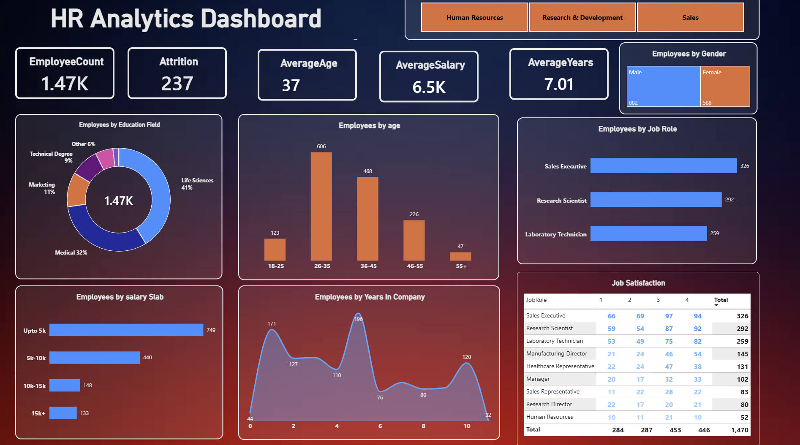

# HR Analytics | Power BI Dashboard

**Tools:** Power BI, DAX | **Data:** HR employee dataset (1,470 employees)

**Headline:** 237 of 1,470 employees have left, an attrition rate of 16.1%.

## Key Insights
1. **Attrition is 16.1%** (237 of 1,470 employees).
2. **The workforce is young and early-tenure.** Average age is 37, and ages 26-45 make up 73% of employees. Average tenure is 7 years.
3. **Three roles make up 60% of employees:** Sales Executive (326), Research Scientist (292) and Laboratory Technician (259).
4. **Pay is concentrated at the low end.** 51% earn up to 5K, while only 9% earn 15K+. Average monthly income is 6.5K.
5. **Job satisfaction is mostly positive.** 61% rate it 3 or 4, but 39% rate it 1 or 2.
6. **Males are 60% of the workforce** (882 vs 588).
7. **Life Sciences and Medical backgrounds account for 73%** of employees by education field.
8. **Headcount peaks at about 1 and 5 years of tenure** (171 and 196 employees).

## Dashboard Preview

## Files
- `HR_Analytics.pbix`: dashboard file
- `Images/`: dashboard screenshot
